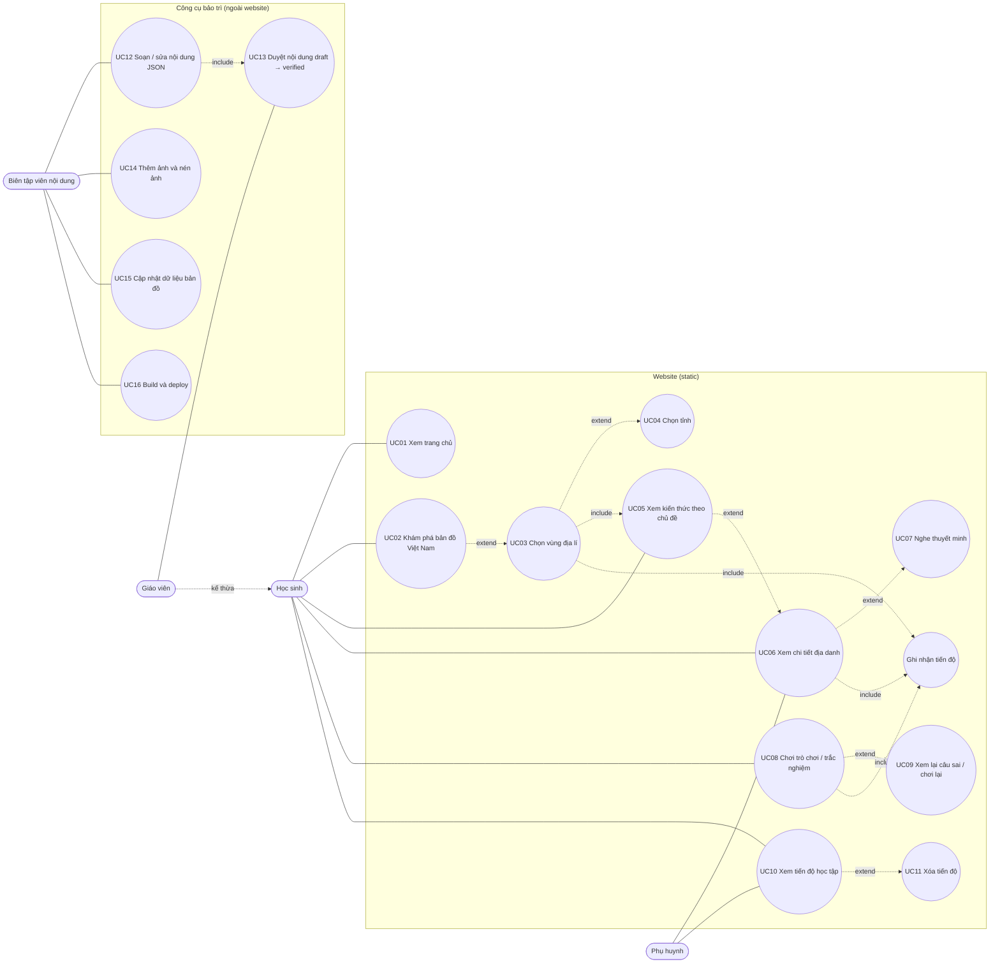

# Use Case — Em khám phá Lịch sử và Địa lí Việt Nam (MVP)

## 1. Tác nhân (Actor)

| Actor | Mô tả |
|---|---|
| **Học sinh** | Học sinh lớp 4, dùng trên máy tính, tablet, điện thoại ở lớp hoặc ở nhà |
| **Giáo viên** | Kế thừa toàn bộ use case của Học sinh; thêm việc trình chiếu trên lớp và duyệt nội dung |
| **Phụ huynh** | Đồng hành cùng con: xem nội dung, xem tiến độ |
| **Biên tập viên nội dung** | Người bảo trì (dev hoặc giáo viên am hiểu kỹ thuật): sửa JSON, thêm ảnh, cập nhật bản đồ, build và deploy. Làm việc ngoài website (trong repo), không có trang quản trị |

## 2. Sơ đồ use case



Phiên bản ASCII (dùng khi không xem được Mermaid):

```text
                 ┌────────────────────────── WEBSITE (static) ──────────────────────────┐
                 │                                                                      │
  Học sinh ──────┼──(UC01 Trang chủ)                                                    │
   ▲   │         │                                                                      │
   │   ├─────────┼──(UC02 Khám phá bản đồ)◄·extend·(UC03 Chọn vùng)◄·extend·(UC04 Tỉnh) │
   │   │         │                                     │include                         │
   │   ├─────────┼──(UC05 Kiến thức theo chủ đề)◄──────┘                                │
   │   │         │            ▲extend                                                   │
   │   ├─────────┼──(UC06 Chi tiết địa danh)◄·extend·(UC07 Nghe thuyết minh)            │
   │   │         │                                                                      │
   │   ├─────────┼──(UC08 Trò chơi/trắc nghiệm)◄·extend·(UC09 Xem lại câu sai/chơi lại) │
   │   │         │      4 dạng: 4 đáp án · Đúng/Sai · Xác định trên bản đồ · Ghép đôi   │
   │   └─────────┼──(UC10 Tiến độ học tập)◄·extend·(UC11 Xóa tiến độ)                   │
   │ kế thừa     │                                                                      │
  Giáo viên      │   UC03, UC06, UC08 ──include──► [Ghi nhận tiến độ → LocalStorage]    │
   │             │                                                                      │
  Phụ huynh ─────┼──(UC06), (UC10)                                                      │
   │             └──────────────────────────────────────────────────────────────────────┘
   │             ┌──────────────── CÔNG CỤ BẢO TRÌ (repo, ngoài website) ───────────────┐
   └─────────────┼──(UC13 Duyệt nội dung)◄·include·(UC12 Soạn/sửa JSON)──── Biên tập viên│
                 │  (UC14 Thêm & nén ảnh)  (UC15 Cập nhật bản đồ)  (UC16 Build & deploy) │
                 └──────────────────────────────────────────────────────────────────────┘
```

## 3. Đặc tả use case

| UC | Tên | Actor | Luồng chính | Luồng phụ / ngoại lệ | Task |
|---|---|---|---|---|---|
| UC01 | Xem trang chủ | HS, PH | Mở `/` → xem giới thiệu, vùng nổi bật, tóm tắt tiến độ → bấm "Khám phá bản đồ" hoặc "Thử tài kiến thức" | Chưa có tiến độ thì hiện lời mời bắt đầu | T11 |
| UC02 | Khám phá bản đồ Việt Nam | HS | Mở `/ban-do` → thấy các vùng tô màu, Hoàng Sa, Trường Sa, Biển Đông → phóng to/thu nhỏ/kéo | Tải bản đồ lỗi: thông báo + "Thử lại", danh sách vùng vẫn dùng được | T5 |
| UC03 | Chọn vùng địa lí | HS | Bấm vùng trên bản đồ hoặc trong danh sách → vùng nổi bật, bản đồ zoom tới vùng, panel hiện tên, tổng quan, 5 chủ đề, marker địa danh → bấm "Về bản đồ Việt Nam" để quay lại | Vùng "Sắp ra mắt": chỉ hiện thẻ thông báo. Chọn được bằng bàn phím | T5, T6 |
| UC04 | Chọn tỉnh | HS | Trong vùng đã chọn, bấm một tỉnh → tỉnh nổi bật, danh sách địa danh lọc theo tỉnh | Chưa có dữ liệu tỉnh: ẩn lớp tỉnh, hiện ghi chú | T6 |
| UC05 | Xem kiến thức theo chủ đề | HS, GV | Chọn 1 trong 5 tab chủ đề → xem các thẻ nội dung có ảnh | Chủ đề trống: "Nội dung đang được cập nhật" | T7 |
| UC06 | Xem chi tiết địa danh | HS, PH | Bấm marker → popup → "Xem chi tiết" (hoặc bấm thẻ) → xem ảnh, vị trí, giới thiệu, đặc điểm nổi bật, "Ghi nhớ", địa danh liên quan → "Về bản đồ" | Id sai: trang "Không tìm thấy". Ảnh lỗi: ô thay thế. Mục không có vị trí: ẩn dòng vị trí | T6, T7 |
| UC07 | Nghe thuyết minh | HS | Bấm phát audio trên trang địa danh | Không có audio: ẩn trình phát. Audio lỗi: hiện thông báo nhẹ | T7 |
| UC08 | Chơi trò chơi / trắc nghiệm | HS, GV | Chọn bài ở `/on-tap` → trả lời từng câu → nhận phản hồi ngay và giải thích → màn kết quả có điểm | Bài không có câu đã duyệt: trạng thái trống. Id sai: "Không tìm thấy" | T9, T10 |
| UC09 | Xem lại câu sai / chơi lại | HS | Trên màn kết quả → "Xem lại câu sai" hoặc "Chơi lại" | — | T9 |
| UC10 | Xem tiến độ học tập | HS, PH | Mở `/tien-do` → vùng đã khám phá, địa danh đã xem, bài đã làm, điểm gần nhất, điểm cao nhất, % hoàn thành, địa danh xem gần đây | Trình duyệt chặn lưu trữ: banner cảnh báo | T8 |
| UC11 | Xóa tiến độ | HS, PH | Bấm "Xóa tiến độ" → hộp xác nhận → xóa | Bấm hủy: giữ nguyên dữ liệu | T8 |
| UC12 | Soạn / sửa nội dung | BT | Sửa `src/data/regions/*.json` theo `CONTENT_GUIDE.md` → chạy `npm test` (kiểm tra toàn vẹn dữ liệu) | Sai cấu trúc: test báo đúng đường dẫn trường lỗi | T2 |
| UC13 | Duyệt nội dung | GV | Đối chiếu với [SGK Lịch sử và Địa lí 4](https://taphuan.nxbgd.vn/tap-huan/doc-sach/sgk-lich-su-va-dia-li-4.4756030172) theo bài và trang ghi trong `sources` → đổi `status` từ `draft` sang `verified` | Chưa duyệt thì không hiện trên bản production | T2 |
| UC14 | Thêm và nén ảnh | BT | Thả ảnh gốc vào `assets-src/images/` → `npm run images` → khai báo `imageId`, alt, credit, license trong JSON | Ảnh quá lớn: script cảnh báo | T3 |
| UC15 | Cập nhật dữ liệu bản đồ | BT | Đặt GeoJSON gốc vào `raw/geo/` → `npm run geo` → cập nhật `DATA_SOURCES.md` | `regionId` không khớp: test báo lỗi | T4 |
| UC16 | Build và deploy | BT | `npm run verify` → push → Vercel/Netlify/Cloudflare build | Vượt ngưỡng dung lượng: verify thất bại | T12 |

## 4. Ngoài phạm vi MVP (đã tính trong kiến trúc, chưa làm)

Tìm kiếm địa danh · Bản đồ chuyên đề · Học theo bài SGK · Nhiệm vụ, huy hiệu · Chế độ trình chiếu riêng cho giáo viên · PWA offline · Video · Trang quản trị nội dung.
